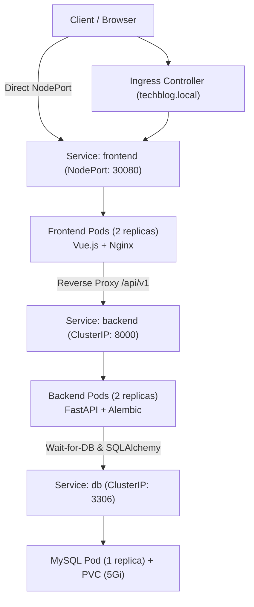

# Kubernetes Deployment Guide for TechBlog

Production-grade Kubernetes manifests for the TechBlog stack using:
- **Frontend Image:** `shanto78/techblog-frontend:v1.0.0`
- **Backend Image:** `shanto78/techblog-backend:v1.0.0`
- **Database:** `mysql:8.0`

---

## Architecture Overview



### Key Highlights
1. **Zero-Crash Startup (initContainers)**: Backend pods wait for MySQL (`db:3306`) to be reachable before starting up and running Alembic database migrations.
2. **Health Checks**: Liveness and readiness probes configured for all services.
3. **Security**: Non-root container security contexts (`appuser` UID 1000 for backend, `nginx` UID 101 for frontend).
4. **Resilience & Storage**: PersistentVolumeClaim ensures MySQL data survives restarts and rescheduling.
5. **Observability**: Prometheus scrape annotations configured on backend pods (`/metrics` on port 8000).

---

## Directory Structure

| File | Description |
|---|---|
| `00-namespace.yaml` | Creates `techblog` namespace |
| `01-configmap.yaml` | Application configuration (database name, user, log level) |
| `02-secret.yaml` | Sensitive passwords, JWT secret, and connection string |
| `03-mysql.yaml` | PersistentVolumeClaim, MySQL Deployment, and `db:3306` Service |
| `04-backend.yaml` | Backend Deployment with initContainer, probes, and `backend:8000` Service |
| `05-frontend.yaml` | Frontend Deployment with probes and `frontend:80` (NodePort 30080) Service |
| `06-ingress.yaml` | Nginx Ingress routing for `techblog.local` |
| `kustomization.yaml` | Kustomize bundle to apply all manifests in order |

---

## Quick Start (Deploy)

### 1. Apply All Manifests

Using Kustomize (recommended):
```bash
kubectl apply -k k8s/
```

Or using standard `kubectl apply`:
```bash
kubectl apply -f k8s/
```

---

### 2. Verify Pod Status

```bash
kubectl get pods -n techblog -w
```

Example expected output:
```text
NAME                        READY   STATUS     RESTARTS   AGE
db-754f98d78b-x7j4k         1/1     Running    0          45s
backend-6b87647895-4lk9q    1/1     Running    0          30s
backend-6b87647895-9wlm2    1/1     Running    0          30s
frontend-7d6f58bb74-2xkpv   1/1     Running    0          30s
frontend-7d6f58bb74-m4n8r   1/1     Running    0          30s
```

Check services:
```bash
kubectl get svc -n techblog
```

---

## Accessing the Application

### Option A: Ingress (Direct Browser Access — No Port Forwarding!)

With the Ingress configured, you do **not** need port-forwarding. Just open your browser at:
- **Frontend Web App:** **`http://localhost/`**
- **Backend API:** **`http://localhost/api/v1/`** (or `http://localhost/api/v1/health`)

*(Requires an Ingress controller like `ingress-nginx` installed in your cluster).*

---

### Option B: NodePort (Minikube / Docker Desktop / Kind)

The frontend is exposed as a NodePort on port **30080**:
- **Minikube:**
  ```bash
  minikube service frontend -n techblog --url
  ```
- **Docker Desktop / Kind / Local VM:**
  Open: **`http://localhost:30080`**

---

### Option C: Port Forwarding (Debugging Only)

If an Ingress Controller is not installed in your cluster yet, you can still tunnel directly:
```bash
kubectl port-forward -n techblog svc/frontend 8080:80
```
Open: **`http://localhost:8080`**

---

## Database Seeding (Optional)

To seed initial blog posts and test accounts:

```bash
# Find the name of one backend pod
BACKEND_POD=$(kubectl get pods -n techblog -l app=backend -o jsonpath="{.items[0].metadata.name}")

# Execute the seed script
kubectl exec -it -n techblog $BACKEND_POD -- python -m app.seed
```

---

## Viewing Logs & Troubleshooting

```bash
# View backend logs (including Alembic migration output)
kubectl logs -n techblog -l app=backend -f

# View frontend logs
kubectl logs -n techblog -l app=frontend -f

# View database logs
kubectl logs -n techblog -l app=db -f

# Describe backend pods if status is Pending or Error
kubectl describe pods -n techblog -l app=backend
```

---

## Cleaning Up / Deleting Stack

```bash
kubectl delete -k k8s/
# Or
kubectl delete namespace techblog
```
